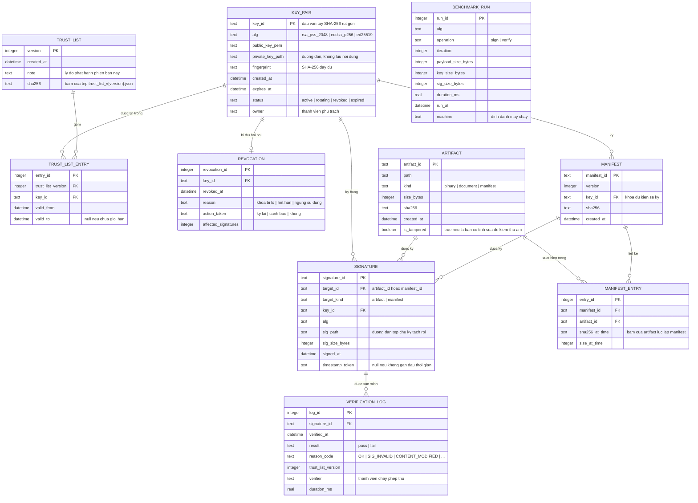

# Mô hình dữ liệu — Sơ đồ ERD

Toàn bộ trạng thái của công cụ nằm trong một tệp SQLite `data/sigtool.db`.
Chọn SQLite vì nhóm nộp kèm được nguyên tệp làm minh chứng, và vì không cần
máy chủ cơ sở dữ liệu trong môi trường lab.

## 1. Sơ đồ quan hệ thực thể

`BENCHMARK_RUN` cố ý **không** nối khóa ngoại với các bảng khác: nó là dữ liệu đo
độc lập, chạy trên artifact tổng hợp, và tách riêng để xóa hoặc chạy lại mà
không ảnh hưởng dữ liệu nghiệp vụ.

## 2. Những quyết định thiết kế đáng giải thích trong báo cáo

| Quyết định | Lý do |
| --- | --- |
| `key_id` là dấu vân tay rút gọn, không phải số tự tăng | Định danh khóa phải suy ra được từ chính khóa, để người xác minh tra được mà không cần hỏi hệ thống |
| Bảng `trust_list_entry` tách riêng thay vì nhét vào `key_pair` | Một khóa có thể hiệu lực ở nhiều phiên bản trust list khác nhau; đây là quan hệ nhiều-nhiều, và nó chính là chỗ giai đoạn chồng lấn được thể hiện |
| `manifest_entry.sha256_at_time` lưu lại mã băm tại thời điểm lập manifest | Để so sánh với mã băm hiện tại của artifact; chênh lệch chính là bằng chứng nội dung bị sửa |
| `signature` lưu đường dẫn tệp chữ ký, không lưu chuỗi byte | Giữ cơ sở dữ liệu nhỏ và nộp kèm được; chữ ký vẫn là tệp độc lập đúng mô hình detached signature |
| `verification_log` không có cột cho phép sửa | Nhật ký kiểm toán phải chỉ ghi thêm; mọi lần xác minh đều để lại dấu vết |
| `artifact.is_tampered` | Đánh dấu rõ bản cố tình sửa phục vụ kiểm thử âm, tránh nhầm với lỗi thật khi đọc lại dữ liệu sau này |

## 3. Ràng buộc toàn vẹn

- `signature.key_id` phải tồn tại trong `key_pair`.
- Một `artifact` chỉ có một `sha256` tại một thời điểm; bản bị sửa là **bản ghi mới**,
  không phải cập nhật bản cũ.
- `trust_list_entry.valid_to` nếu khác null thì phải lớn hơn `valid_from`.
- `revocation.key_id` là duy nhất: một khóa chỉ bị thu hồi một lần.
- `verification_log.reason_code` phải thuộc tập mã lý do trong tài liệu đặc tả yêu cầu.
