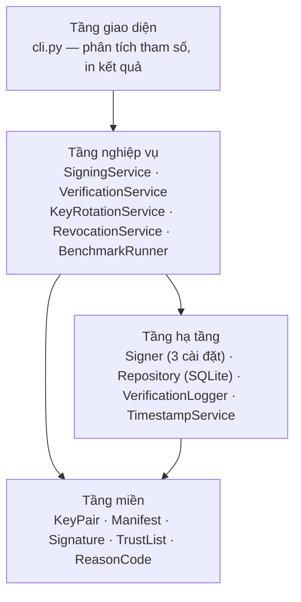
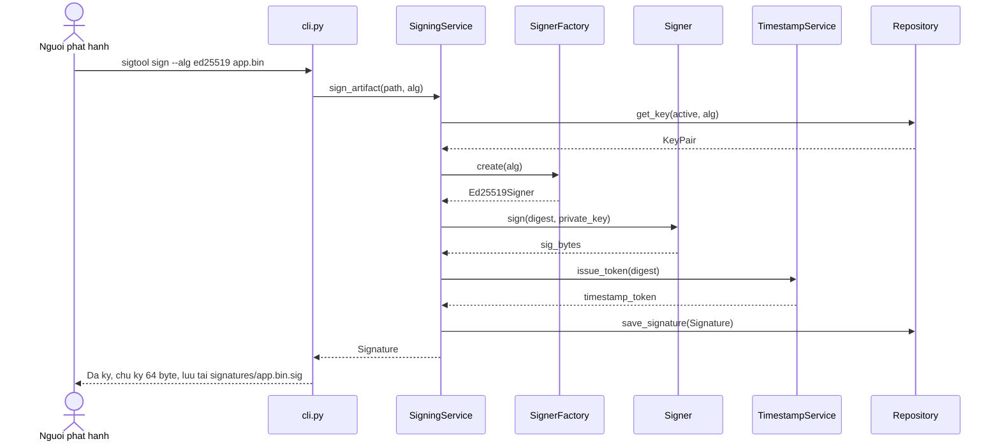
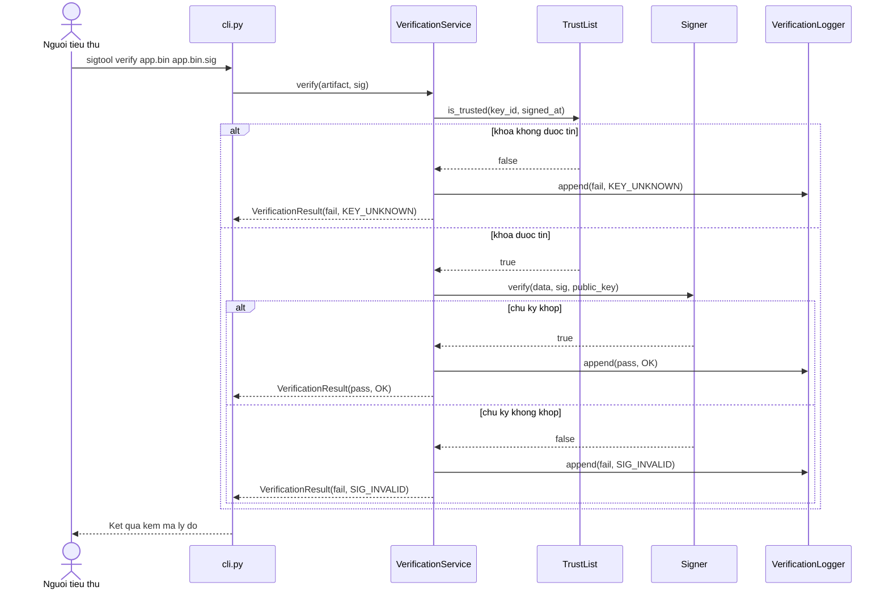

# Sơ đồ lớp và kiến trúc

## 1. Phân tầng

Ba tầng, phụ thuộc chỉ đi một chiều từ trên xuống. Tầng dưới không biết gì về tầng trên.

Lý do tách: phần **nghiệp vụ** phải kiểm thử được mà không cần đụng tới đĩa hay
cơ sở dữ liệu. Khi `SigningService` chỉ phụ thuộc vào giao diện `Signer` chứ không
phụ thuộc vào `Ed25519Signer` cụ thể, bộ kiểm thử thay được bằng bản giả lập.

## 2. Sơ đồ lớp

```mermaid
classDiagram
    direction TB

    class Algorithm {
        <<enumeration>>
        RSA_PSS_2048
        RSA_PSS_3072
        ECDSA_P256
        ED25519
    }

    class ReasonCode {
        <<enumeration>>
        OK
        SIG_INVALID
        CONTENT_MODIFIED
        METADATA_MODIFIED
        KEY_UNKNOWN
        KEY_REVOKED
        KEY_EXPIRED
        TIMESTAMP_INVALID
        MANIFEST_VERSION_MISMATCH
    }

    class KeyPair {
        +str key_id
        +Algorithm alg
        +str fingerprint
        +datetime created_at
        +datetime expires_at
        +str status
        +is_valid_at(moment) bool
        +public_bytes() bytes
    }

    class Manifest {
        +str manifest_id
        +int version
        +str key_id
        +list~ManifestEntry~ entries
        +add(artifact) void
        +to_json() str
        +canonical_bytes() bytes
        +verify_contents(root_dir) ReasonCode
    }

    class ManifestEntry {
        +str artifact_id
        +str path
        +str sha256_at_time
        +int size_at_time
    }

    class Signature {
        +str signature_id
        +str target_id
        +str target_kind
        +str key_id
        +Algorithm alg
        +int sig_size_bytes
        +datetime signed_at
        +str timestamp_token
    }

    class TrustList {
        +int version
        +datetime created_at
        +list~TrustEntry~ entries
        +is_trusted(key_id, moment) bool
        +load(path)$ TrustList
        +save(path) void
    }

    class Signer {
        <<interface>>
        +generate_key() KeyPair
        +sign(data, private_key) bytes
        +verify(data, sig, public_key) bool
        +signature_size() int
    }

    class RsaPssSigner {
        -int key_size
    }
    class EcdsaSigner {
        -str curve
    }
    class Ed25519Signer {
    }

    class SignerFactory {
        +create(alg)$ Signer
    }

    class SigningService {
        -Signer signer
        -Repository repo
        -TimestampService clock
        +sign_artifact(path, alg) Signature
        +sign_manifest(manifest, alg) Signature
    }

    class VerificationService {
        -Repository repo
        -TrustList trust_list
        -VerificationLogger logger
        +verify(artifact_path, sig_path) VerificationResult
        +verify_manifest(manifest_path) VerificationResult
    }

    class VerificationResult {
        +bool passed
        +ReasonCode reason
        +str message_vi
        +float duration_ms
    }

    class KeyRotationService {
        -int overlap_days
        +rotate(old_key, new_alg) TrustList
        +publish_trust_list() int
    }

    class RevocationService {
        +revoke(key_id, reason) Revocation
        +list_affected(key_id) list~Signature~
        +resign_all(key_id, new_key) int
    }

    class BenchmarkRunner {
        -int iterations
        +run(alg, payload_size) list~BenchmarkRow~
        +export_csv(path) void
    }

    class Repository {
        <<interface>>
        +save_key(kp) void
        +get_key(key_id) KeyPair
        +save_signature(sig) void
        +find_signatures_by_key(key_id) list~Signature~
    }

    class SqliteRepository {
        -str db_path
    }

    class VerificationLogger {
        -str log_path
        +append(result, sig) void
    }

    class TimestampService {
        +now() datetime
        +issue_token(digest) str
        +check_token(token, digest) bool
    }

    Signer <|.. RsaPssSigner
    Signer <|.. EcdsaSigner
    Signer <|.. Ed25519Signer
    SignerFactory ..> Signer : tao
    SignerFactory ..> Algorithm : doc

    SigningService --> Signer
    SigningService --> Repository
    SigningService --> TimestampService
    SigningService ..> Signature : tao

    VerificationService --> Repository
    VerificationService --> TrustList
    VerificationService --> VerificationLogger
    VerificationService ..> VerificationResult : tra ve
    VerificationResult --> ReasonCode

    KeyRotationService --> TrustList
    KeyRotationService --> Repository
    RevocationService --> Repository
    BenchmarkRunner --> SignerFactory

    Repository <|.. SqliteRepository
    Manifest o-- ManifestEntry
    KeyPair --> Algorithm
    Signature --> Algorithm
```

## 3. Vì sao thiết kế như vậy

**`Signer` là giao diện, ba thuật toán là ba cài đặt.** Đây là chỗ đáng viết nhất
trong báo cáo: nhờ vậy việc thêm một thuật toán thứ tư không đụng vào
`SigningService`, và `BenchmarkRunner` chạy vòng lặp trên cả ba mà không cần
biết chúng khác nhau ra sao bên trong.

**`VerificationService` trả về `VerificationResult` chứ không trả về `bool`.**
Yêu cầu FR-11 đòi mã lý do cụ thể khi thất bại. Một hàm trả `True`/`False`
không đáp ứng được, và cũng không ghi nổi nhật ký có ý nghĩa.

**`Repository` là giao diện, SQLite chỉ là một cài đặt.** Bộ kiểm thử dùng bản
lưu trong bộ nhớ, chạy nhanh và không để lại tệp rác.

**`TimestampService` tách riêng** để kiểm thử bơm được thời gian giả. Muốn kiểm
tra "khóa hết hạn tại thời điểm ký" mà phải chờ khóa hết hạn thật thì không
kiểm thử được.

## 4. Luồng ký và xác minh

