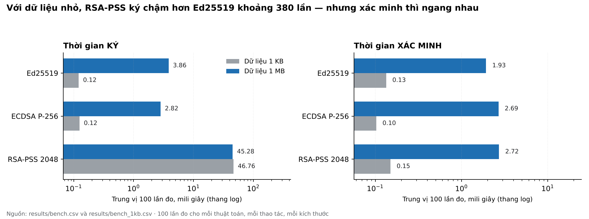

# Kết quả thực nghiệm

Toàn bộ số liệu dưới đây là kết quả chạy thật, không phải con số ước lượng.
Dữ liệu thô nằm ở `results/bench.csv` và `results/bench_1kb.csv`, mỗi tệp
600 dòng. Chạy lại bằng:

```bash
python -m dt19 bench --iterations 100 --size 1048576 --out results/bench.csv
python -m dt19 bench --iterations 100 --size 1024    --out results/bench_1kb.csv
```

## 1. Baseline — mốc so sánh

Trước khi đo phải chốt mốc so sánh, nếu không thì con số đo ra chẳng so với
cái gì cả. Nhóm chọn ba mốc:

| Mốc | Định nghĩa | Dùng để trả lời |
| --- | --- | --- |
| **B1 — Ed25519** | Thuật toán nhanh nhất về lý thuyết, lấy làm mốc 1,0× | Hai thuật toán kia chậm hơn bao nhiêu lần |
| **B2 — Dữ liệu 1 KB** | Kích thước nhỏ đến mức chi phí băm không đáng kể | Chi phí thuần của phép toán mật mã |
| **B3 — Ngưỡng NFR-01** | Xác minh dưới 50 ms với tệp 1 MB | Công cụ có đủ nhanh để dùng thật không |

Đo ở hai kích thước là có chủ ý. Nếu chỉ đo ở 1 MB, chi phí băm sẽ trộn lẫn
vào chi phí ký và nhóm sẽ kết luận sai.

## 2. Số liệu



Trung vị của 100 lần đo, đơn vị mili giây:

| Thuật toán | Ký 1 KB | Ký 1 MB | Xác minh 1 KB | Xác minh 1 MB | Chữ ký (byte) |
| --- | ---: | ---: | ---: | ---: | ---: |
| Ed25519 | 0,121 | 3,858 | 0,134 | 1,928 | 64 |
| ECDSA P-256 | 0,125 | 2,821 | 0,103 | 2,687 | 71 |
| RSA-PSS 2048 | 46,755 | 45,284 | 0,150 | 2,725 | 256 |

## 3. Bốn điều số liệu nói ra

**Thứ nhất, RSA-PSS ký chậm hơn hẳn — gấp 385 lần Ed25519 ở dữ liệu 1 KB.**
Nguyên nhân là phép mũ modulo với số mũ bí mật dài 2048 bit. Đây không phải
chi tiết cài đặt mà là bản chất của RSA.

**Thứ hai, thời gian ký của RSA gần như không đổi theo kích thước dữ liệu:
46,76 ms với 1 KB và 45,28 ms với 1 MB, tức tỷ lệ 0,97 lần.** Toàn bộ chi phí
nằm ở phép toán trên mã băm, không ở việc đọc dữ liệu. Điều này xác nhận cơ
chế "băm trước, ký sau" mà bài giảng mô tả: thuật toán chữ ký không bao giờ
ký trực tiếp lên thông điệp dài.

**Thứ ba, ở dữ liệu 1 MB, khác biệt giữa Ed25519 và ECDSA gần như biến mất**
(3,86 ms so với 2,82 ms), trong khi ở 1 KB cả hai đều khoảng 0,12 ms. Lý do:
băm 1 MB mất khoảng 2–3 ms, lấn át phần mật mã vốn chỉ hết 0,12 ms. Nếu nhóm
chỉ đo ở 1 MB thì đã kết luận "ba thuật toán gần như nhau về tốc độ ký", và
kết luận đó sai.

**Thứ tư, RSA xác minh nhanh ngang hai thuật toán kia** (0,15 ms so với 0,13
và 0,10 ms ở 1 KB), dù ký thì chậm gấp hàng trăm lần. Đây là tính bất đối
xứng đặc trưng của RSA: số mũ công khai thường là 65537, rất nhỏ, nên phép
mũ khi xác minh rẻ hơn nhiều so với khi ký.

**Hệ quả thực tế:** với bài toán ký phần mềm, một artifact được ký một lần
nhưng được hàng nghìn người xác minh. Nếu chỉ nhìn cột "ký", RSA trông tệ;
nhưng chi phí ký trả một lần, còn chi phí xác minh nhân lên theo số người
dùng. Kích thước chữ ký mới là thứ nhân lên: 256 byte so với 64 byte, gấp
bốn lần, và chỗ đó mới đáng cân nhắc khi phân phối hàng triệu bản.

## 4. Đối chiếu với ngưỡng đã đặt

| Chỉ số | Ngưỡng | Kết quả | Kết luận |
| --- | --- | --- | --- |
| NFR-01 — xác minh 1 MB | dưới 50 ms | cao nhất 2,73 ms | Đạt, dư rất nhiều |
| NFR-02 — số lần lặp | từ 100 | 100 mỗi tổ hợp, 1.200 dòng dữ liệu | Đạt |
| NFR-09 — độ phủ kiểm thử | từ 70% | 94% | Đạt |
| Ca kiểm thử | 22/22 đạt | 22/22 | Đạt |

## 5. Kết quả kiểm thử phát hiện sai lệch

Bốn cách phá hoại khác nhau cho ra bốn mã lý do khác nhau. Đây là phần quan
trọng hơn số liệu tốc độ, vì nó chứng minh công cụ **phân biệt được nguyên
nhân** chứ không chỉ nói "sai".

| Hành vi phá hoại | Mã lý do trả về | Ca kiểm thử |
| --- | --- | --- |
| Sửa một byte trong tệp đã ký | `CONTENT_MODIFIED` | TC-03 |
| Đổi tên tệp, giữ nguyên nội dung | `METADATA_MODIFIED` | TC-04 |
| Sửa manifest đã được ký | `SIG_INVALID` | TC-05 |
| Thay tệp chữ ký bằng rác | `SIG_INVALID` | TC-06 |
| Ký bằng khóa không có trong trust list | `KEY_UNKNOWN` | TC-07 |
| Dùng khóa cũ sau giai đoạn chồng lấn | `KEY_EXPIRED` | TC-10 |
| Chữ ký tạo sau thời điểm thu hồi | `KEY_REVOKED` | TC-11 |

Trường hợp `KEY_UNKNOWN` đáng chú ý nhất. Chữ ký trong ca đó **hoàn toàn hợp
lệ về mặt mật mã**, nhưng vẫn bị từ chối vì khóa không được tin. Nó cho thấy
xác minh chữ ký gồm hai câu hỏi tách biệt: phép toán có đúng không, và người
ký có đáng tin không. Công cụ phải trả lời cả hai, và phải trả lời câu thứ
hai trước.

## 6. Quan sát về nonce tất định

Ký cùng một thông điệp hai lần bằng Ed25519 cho ra **hai chữ ký giống hệt
nhau**; ECDSA và RSA-PSS thì mỗi lần một khác. Kiểm chứng bằng ca
`test_ed25519_sinh_nonce_tat_dinh`.

Đây là bằng chứng quan sát được của cơ chế `k = H(prefix || M)`: nonce suy ra
từ khóa riêng và thông điệp chứ không lấy từ bộ sinh số ngẫu nhiên. Nhờ vậy
Ed25519 miễn nhiễm với lỗi tái sử dụng nonce — lỗi mà nếu xảy ra với ECDSA sẽ
làm lộ toàn bộ khóa riêng.

## 7. Giới hạn của số liệu

- Đo trên một máy duy nhất, trong container Linux. Máy khác sẽ cho con số khác;
  **thứ tự giữa ba thuật toán mới là thứ đáng tin**, không phải giá trị tuyệt đối.
- Trung vị che đi phần đuôi: p95 của RSA khi ký lên tới 76,79 ms, gấp 1,6 lần
  trung vị. Hệ thống cần độ trễ ổn định phải nhìn p95 chứ không nhìn trung vị.
- Chưa đo mức tiêu thụ bộ nhớ và chưa đo trên thiết bị yếu.
- Dấu thời gian là mô phỏng cục bộ, không phải dịch vụ TSA độc lập.
